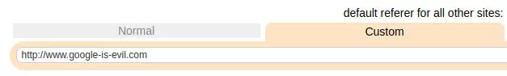
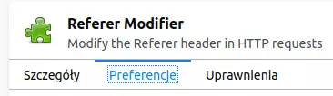
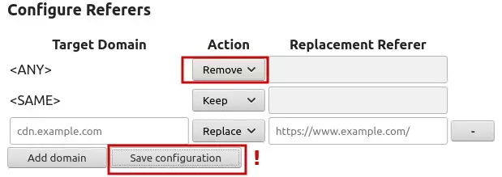

W poprzednim wpisie pokazałem krótko nagłówki HTTP -- rodzaj naszej wizytówki przesyłanej za każdym razem, kiedy odwiedzamy strony internetowe. 
 
Teraz skupię się na jednym z&nbsp;tych nagłówków, *refererze* (po polsku *strona odsyłająca*). Jego działanie było dla mnie kompletną niespo&shy;dzianką. Mimo że jest czymś absolutnie powszechnym.

Krótko: **kiedy przechodzimy między stronami internetowymi, właściciele drugiej strony często się dowiadują, jaka była ta pierwsza. I&nbsp;przekazują to innym**.

Zaskoczeni?

Zamiast opisywać suche fakty, pokażę Wam referera w&nbsp;akcji.



<a id="experiment"/>
## Referer w&nbsp;praktyce

Poniżej mamy dwa linki. Oba prowadzą do tej samej strony, na której się teraz znajdujemy. Kliknij i&nbsp;zobacz, jaki referer wyświetli się w&nbsp;czarnym polu pod nimi:

1. <a href="">Pierwszy link (z refererem)</a>.  
2. <a href="" rel="noreferrer">Drugi link (bez referera)</a>.  

Przychodzisz ze strony:
<div class="black-bg"><strong id="reff">Masz wyłączony JavaScript!</strong></div>



Wniosek? Strona domyślnie dowiaduje się, skąd przychodzę, chyba że celowo coś zmienię (o tym pod koniec wpisu).

<a id="leaks-test"/>No ale dobra, możesz powiedzieć. Co z&nbsp;tego? Ciemna Strona dowiaduje się, że przychodzę z&nbsp;Ciemnej Strony. Nic specjalnego.  
Póki poruszasz się po jednej stronie, nie pobierając nic z&nbsp;zewnątrz, referer to faktycznie bzdet. Spróbuj jednak odwiedzić jakąś stronkę zewnętrzną, taką jak *BrowserLeaks*:

<a href="https://browserleaks.com/ip">*Browserleaks.com* z&nbsp;refererem z&nbsp;Ciemnej Strony</a>

{:.bigspace-after .post-meta}
Strona zawiera tabelkę z różnymi informacjami. Ta interesująca jest nieco niżej, pod nagłówkiem *HTTP Headers*, w linijce podpisanej *Referer*. Jeśli nie ma takiej linijki, to znaczy że nie przesłało referera. Jest anonimowość :sunglasses:

Zwykle po wejściu w taki link „niesiesz” ze sobą na stronę B&nbsp;informację o&nbsp;tym, że przybywasz z&nbsp;Ciemnej Strony (strona&nbsp;A).

Co więcej, bardziej gadatliwa strona B&nbsp;mogłaby odsyłać do różnych rzeczy ze stron C, D&nbsp;i&nbsp;kolejnych. Też dowiedziałyby się, że przeszliśmy z&nbsp;A do B.

Chcieliśmy tylko odwiedzić jedną stronę przez link. A&nbsp;ta papla *przesłała obcym stronom nasz nagłówek, razem z&nbsp;refererem*. Więc, tak jak w&nbsp;przypadku plotkar i&nbsp;plotkarzy z&nbsp;prawdziwego życia, teraz wiedzą już wszyscy.

{:.post-meta .bigspace-after}
Dlaczego tak się tym dzielą? Dla wygody, to jak *outsourcing* pewnych części strony. Zamiast trzymać własne czcionki, mogą odsyłać do Google Fonts; nie analizują ruchu samodzielnie, tylko ślą dane do Google Analytics.

Co więcej, tak się dzieje nawet wtedy, kiedy zależy nam na prywatności. **Przeglądanie w&nbsp;trybie prywatnym/incognito nie wyłącza przekazywania refererów**. Nie robi tego nawet wiele dodatków blokujących reklamy śledzące.

Zdziwieni?

Na pocieszenie powiem, że na niektórych stronach przekazywanie refererów jest wyłączone. Poza tym są one przesyłane *tylko wtedy, kiedy klikamy w&nbsp;linki*.  
Chodzenie między stronami przez `Wstecz` i&nbsp;`Dalej`, odświeżanie strony, wklejanie adresu w&nbsp;pasek przeglądarki -- żadna z&nbsp;tych rzeczy nie wyśle informacji o&nbsp;tym, gdzie byliśmy poprzednio.

## Ciemne strony referera

Referer podobno nie powstał w&nbsp;złych celach, tylko jest takim trochę reliktem dawnej sieci, który ułatwiał stronom tworzenie powiązań.

Mimo to jest kilka sposobów, w&nbsp;jakie może zostać użyty przeciwko nam:

* **Sam link do strony może sugerować coś wstydliwego**

  Przykład: [9 na 10 stron poświęconych problemom zdrowotnym łączyło się z innymi stronkami, przekazując przy tym nagłówki użytkowników](https://nakedsecurity.sophos.com/2015/02/26/how-nine-out-of-ten-healthcare-pages-leak-private-data/).  
  Dzięki temu firmy analityczne i&nbsp;reklamowe dostawały paczkę informacji. Na podstawie niektórych, na przykład plików *cookies*, mogły zapewne rozpoznać konkretnych użytkowników. A&nbsp;do tego w&nbsp;pakiecie dostawały referera pokazującego, że ta osoba oglądała właśnie podstrony o&nbsp;chorobach wenerycznych.

* **Referer może być częścią naszej „teczki”**

  Nawet jeśli nie wstydzimy się miejsca, z którego przybywamy, odwiedzane strony mogą je połączyć z&nbsp;innymi informacjami, jakie o&nbsp;nas zbiorą i&nbsp;nas na tej podstawie profilować. Później mogą ujawnić profil firmom marketingowym (albo szerszej publice, jeśli ich dane wyciekną).

* **Zdradza popularność stron**

  Odpowiednik takiego „kto przeglądał twój profil” na LinkedInie.  
  Czasami popularność nie jest fajną rzeczą. Jeśli administrator jakiejś strony A analizuje referery, to może zobaczyć, że trafia na nią coraz więcej użytkowników ze stronki B. Zaciekawiony może ją sprawdzić. A co, jeśli strona B to na przykład forum, na którym często beszta się stronę A? Albo konkurencja? W ten sposób strona A może podjąć działania przeciw B. O&nbsp;której by się nie dowiedziała, gdyby nie referery.

* **Umacnia kontrolę internetowych gigantów**

  Trochę jak poprzedni punkt, ale w&nbsp;wersji na dużą skalę. Referery to cenne informacje o&nbsp;dynamice powiązań w&nbsp;internecie. Firmy takie jak Google mogą dawać innym [możliwość analizowania ruchu](https://support.google.com/google-ads/answer/2382957?hl=pl-PL) na stronie. Ale kto im zabroni liczyć przy tym referery i&nbsp;mieć wgląd w&nbsp;kawał internetu?  
Dzięki temu widzą jako jedni z&nbsp;pierwszych, jakie strony (a&nbsp;zatem również poglądy, organizacje itp.) rosną w&nbsp;siłę, a&nbsp;jakie słabną. Dokąd warto włożyć ręce, żeby jeszcze bardziej umocnić swoją pozycję.  
Czy tak robią? Na chwilę obecną chcę bardziej wczytać się w&nbsp;temat, więc nie powiem. Ale sama możliwość nie napawa optymizmem.

To tyle tytułem wiedzy. Mam nadzieję że trochę Cię zaskoczyłem.  
Jeśli chcesz coś z&nbsp;tym zrobić (jako użytkownik lub właściciel strony), to czytaj dalej! 

## Jak ukrywać referery

Można to zrobić bardzo łatwo. Zależy od tego, do której grupy należysz:

### Wolisz nic nie zmieniać ani nie instalować

...W sumie niezbyt Cię obchodzą te całe referery. Albo może nie używasz swojego komputera i&nbsp;nie chcesz tak po prostu czegoś na nim zmieniać.

Ale załóżmy, że chcesz jednorazowo ukryć referera. Na przykład jesteś na jakiejś dość „osobistej” stronce A. Jest na niej link do strony B. I&nbsp;trochę jednak nie chcesz, żeby ktoś ze strony B&nbsp;zobaczył, skąd przychodzisz.

Rozwiązanie: **zamiast klikać w&nbsp;link, skopiuj go do głównego paska przeglądarki**.  
Znane mi przeglądarki (Firefox, mobilny Firefox Focus i&nbsp;Chrome, a&nbsp;pewnie wiele innych) nie wysyłają wtedy referera. A&nbsp;na stronkę wejdziesz.

Możesz to przetestować, kopiując do paska <a href="https://browserleaks.com/ip">ten link, który normalnie przesłałby referera</a> (do BrowserLeaks).



### Chcesz ukryć na stałe przez opcje przeglądarki



Wyłączenie *referera* przez przeglądarkę to złoty środek. Nie trzeba pamiętać o kopiowaniu linków do paska. Ani się uzależniać od zewnętrznych dodatków (których autorzy też mogą ulec pokusie monetyzowania biednych internautów :wink:). Do tego to po prostu łatwe.
 
Warto jedynie pamiętać o tym, że się taką opcję zaznaczyło. Tak na wypadek, gdyby jakaś stronka nie działała bez *referera*.

Poniżej instrukcje dla Firefoksa, w wolnym czasie może dodam ich więcej.



{:.post-meta .bigspace-before}
Dotyczy też przeglądarek pochodnych, jak Librewolf.

Żeby całkowicie wyłączyć przesyłanie referera:

* wpisz w górny pasek (ten od linków) tekst `about:config` i naciśnij `Enter`;
* zamknij ostrzeżenie, jeśli się jakieś pojawi;
* wpisz w pasek wyszukiwania `referer` i znajdź na dole listy opcję `network.http.sendRefererHeader`;
* kliknij ikonę ołówka po prawej stronie, na wysokości opcji, żeby wejść w tryb edycji;
* wpisz wartość `0` (zamiast domyślnej `2`) i potwierdź, klikając przycisk.



Po dokonaniu zmiany można się upewnić, choćby przez [wspomnianą wyżej](#leaks-test){:.internal} *Browser Leaks*, że referera już nie ma.

### Chcesz ukryć na stałe innym sposobem

Jak pisałem wyżej -- proponuję trzymać się opcji przeglądarki. Ale jeśli nie pozwalają na ingerencję, to można sięgnąć po jakiś dodatek.

 

{:.bigspace-before}
Dodatki pozwalają czasem nie tylko wyłączać, ale i zmieniać referery. Zacznę od wesołego przykładu z udziałem dodatku *Referer Control*, który chyba jest już przeszłością (dawny link przestał działać).

{% include info.html type="Heheszki"
text="Jeśli masz nastrój na śmieszkowanie, możesz ustawić jako referer dowolny tekst, jaki tylko Ci się podoba -- wystarczy kliknąć zakładkę `Custom` i&nbsp;wpisać go w&nbsp;polu.  
Według [tego źródła](https://stackoverflow.com/questions/11798451/what-is-the-maximum-length-of-referer) referer może liczyć do 2000 znaków, więc całkiem długa rozprawka by się zmieściła.  
Sam natomiast zachęcam do trollowania podglądaczy czymś krótkim, treściwym i&nbsp;wyglądającym jak prawdziwy adres strony:" trailer="<p class='figure'></p>" %}

A po śmieszkach czas na konkretny dodatek, **_Referer Modifier_**.

{:.nospace}
{% include web-extension.html firefox="
<ol>
  <li>
    <p>Instalujemy <a href='https://addons.mozilla.org/en-US/firefox/addon/referer-modifier/'>dodatek <em>Referer Modifier</em></a> z&nbsp;oficjalnej stronki Mozilli (można się upewnić <a href='https://github.com/airtower-luna/referer-mod'>przez stronę z kodem źródłowym</a>, że to faktycznie ten dodatek).</p>
  </li>
  <li>Dodatek będzie niewidoczny na pasku, więc musimy wejść do menu dodatków (np. przez menu główne albo naciskając <code class='language-plaintext highlighter-rouge'>Ctrl+Shift+A</code>).</li>
  <li>
    <p>Wybieramy go z&nbsp;listy i&nbsp;klikamy w&nbsp;zakładkę <code class='language-plaintext highlighter-rouge'>Preferencje</code>:</p>

    <p class='figure bigspace'></p>
  </li>
  <li>
    <p>Patrzymy na opcje, naciskamy guzik na prawo od napisu <em>ANY</em> i&nbsp;wybieramy opcję <code class='language-plaintext highlighter-rouge'>Remove</code>. Przy <em>SAME</em> najbezpieczniejsza jest z&nbsp;kolei opcja <code class='language-plaintext highlighter-rouge'>Keep</code>:</p>

    <p class='figure bigspace'></p>
  </li>
  <li>
    <p><strong>Ważne!</strong> Klikamy przycisk <code class='language-plaintext highlighter-rouge'>Save configuration</code>. Nic się nie wyświetli, ale nasze ustawienia zostaną zapisane.</p>

    <p>Referer nie będzie wysyłany, jeśli klikniemy na stronie A link do strony B. Ale będzie działał w&nbsp;obrębie jednej strony (czyli np. Ciemna Strona → Ciemna Strona).</p>
  </li>
  <li>Testujemy na linkach z&nbsp;tej strony, czy wszystkie referery usunięte.</li>
</ol>
" 
inne-pc="
<p>Z tego co wiem, ten dodatek działa jedynie na Firefoksie.</p>"
inne-mobile="
<p>Na telefonie jest trudniej, ponieważ większość przeglądarek nie daje Wam możliwości instalowania dodatków.</p>
<p>Chwalebnym wyjątkiem na Androidzie jest Firefox (nie <em>Focus/Klar</em> ani inne specjalne wersje, tylko ta główna). <span class='corr-del'>Powinno dać się na nim zainstalować <em>Referer Modifiera</em>, o&nbsp;którym wcześniej wspominałem.</span><br/>
<strong>Aktualizacja:</strong> Sprawdziłem i&nbsp;niestety trzeba albo użyć starszej wersji, albo pogmerać w&nbsp;ustawieniach najnowszej nieoficjalnej (tzw. <em>Nightly</em>); wersje aktualne dopuszczają póki co tylko wybrane dodatki.</p>
<p>Nie wiem, jak jest na iOS (iPhone'ach). Wiem jedynie, że wszystkie przeglądarki na tym systemie muszą korzystać z&nbsp;silnika Safari (również Chrome i&nbsp;Firefox!). Więc jeśli Safari nie daje możliwości usuwania refererów, to niestety mamy pecha.</p>
"%}



### Masz swoją stronkę i&nbsp;nie chcesz zdradzać refererów użytkowników

To się ceni! :+1:

Jeśli używasz do tworzenia swojej strony popularnego Wordpressa, to możliwe że nie musisz nic robić. Według [tego artykułu](https://www.reliablesoft.net/noreferrer-noopener/) **Wordpress automatycznie wyłącza przekazywanie refererów**.

Natomiast jeśli musisz samodzielnie usunąć referery, jednym ze sposobów jest dodanie atrybutu `rel="noreferrer"` do tych linków, które nie powinny ich przekazywać. Wyglądają wtedy tak:

<div class="black-bg mono">&lt;a href="TWÓJ_LINK" <span class="red">rel="noreferrer"</span>&gt;</div>

Możesz też wyłączyć wszystkie referery za jednym zamachem. Wystarczy że **dodasz jedną linijkę do głównego szablonu swojej strony**, w&nbsp;jej elemencie `head`. Ta linijka to:

```
<meta name="referrer" content="same-origin"/>
```

Jeśli ją dodasz -- i&nbsp;nie wyłączysz żadną inną regułką -- referery będą działały tylko w&nbsp;obrębie Twojej stronki, a&nbsp;w&nbsp;przypadku linków do stron zewnętrznych będą usuwane. Obce strony nie zobaczą, że ktoś przyszedł od Ciebie.

Taką właśnie metodę wybrałem dla Ciemnej Strony. Do szablonu dodałem regułkę wskazującą, żeby zawsze usuwać referery. Na&nbsp;tej stronie wyjątkowo jej nie ma, żeby dało się pokazać ich działanie.

Możesz natomiast wejść na dowolną inną podstronkę -- na przykład stronę główną -- i&nbsp;spojrzeć w&nbsp;źródło strony (`prawy przycisk myszy → Pokaż źródło`).  
O ile nic nie zmieniałem, element wyłączający referery będzie w&nbsp;linijce 7&nbsp;od góry.

<script>
var referrer = document.referrer;
if (referrer == "") {referrer = "(referer nieznany)"};
document.getElementById("reff").innerHTML = referrer;
</script>
