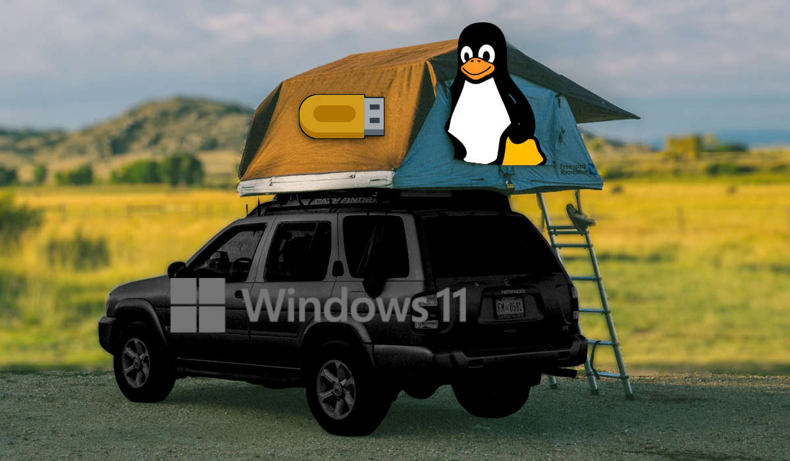
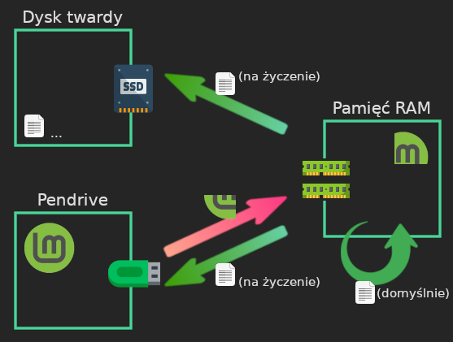
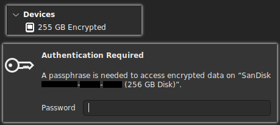

Większość osób korzysta z&nbsp;komputera w&nbsp;ten sam, typowy sposób. Naciskają przycisk zasilania i&nbsp;czekają aż załaduje się system, zainstalowany kiedyśtam na dysku.

System się włącza, często jest nim Windows. Wiele osób go używa, lubi coraz mniej. Za to, że wpycha inwazyjną telemetrię, reklamy, AI, niedopracowane aktualizacje... jakby sugerował użytkownikom, że są tylko gośćmi na swoim urządzeniu.

Ale na Windowsie są czasem programy, bez których trudno żyć, więc ludzie tkwią w&nbsp;swojej rutynie. Włączają system, korzystają, wyłączają. Na dysku gromadzą się ich osobiste pliki, jak klamoty na strychu. Nazwa użytkownika ta sama od lat. Do stworzonych plików zaglądają systemowe usługi, a&nbsp;czasem również wścibskie programy z&nbsp;zewnątrz.  

Da się żyć inaczej.

Każda posiadówka przed komputerem może być jak nowa przygoda.  
Rozpoczęta niemal od zera, z&nbsp;czystą kartą. Przygoda, podczas której możesz zmieniać, a&nbsp;nawet popsuć aktywny system, bo i&nbsp;tak się wskrzesi. Nie rozpoznają cię po zachomikowanych plikach -- bo ich nie masz (tzn. nadal masz, tylko w&nbsp;innym miejscu). **To jak tryb prywatny przeglądarki na poziomie systemu**.

I najlepsze -- możesz tej przygody skosztować, nie zmieniając domyślnego systemu. Niech tam sobie śpi u&nbsp;podstaw, nietykany i&nbsp;niezmieniany, podczas gdy ty zaznasz dla odmiany wolności. A&nbsp;gdy go obudzisz, nie będzie nic wiedział o&nbsp;twoich przygodach. Bo nie zostanie po nich ani ślad.

W tym wpisie mam zaszczyt przedstawić **tryb _live_ (ulotny)**, oparty na ładowaniu systemu z&nbsp;pendrive'a prosto do pamięci. Potężny oręż w&nbsp;walce o&nbsp;cyfrową prywatność.

{:.figure .bigspace-before}


Pingwin Tux (logo Linuksa), logo Windowsa z&nbsp;Wikimedia Commons, [zdjęcie](https://unsplash.com/photos/brown-suv-parking-with-tent-on-top-kvvzF4dQEpg) ze strony Unsplash (autor: *mjaleo*), [pendrive](https://www.flaticon.com/free-icon/pendrive_167505) ze strony Flaticon. Przeróbki moje. 


## Spis treści

* [Na czym to polega?](#na-czym-to-polega)
* [Tryb ulotny a&nbsp;prywatność](#tryb-ulotny-aprywatność)
  * [Ochrona przed profilowaniem przez strony internetowe](#ochrona-przed-profilowaniem-przez-strony-internetowe)
  * [Ochrona przed głupimi błędami](#ochrona-przed-głupimi-błędami)
  * [Ochrona przed programami-szperaczami](#ochrona-przed-programami-szperaczami)
  * [Ograniczenia trybu ulotnego](#ograniczenia-trybu-ulotnego)
* [Jak rozpocząć swoją przygodę?](#jak-rozpocząć-swoją-przygodę)

## Na czym to polega?

Zacznę od zaskoczenia: **wejście w&nbsp;tryb _live USB_ często jest prostsze niż instalacja systemu na stałe**. A&nbsp;to dlatego, że nieraz jest on etapem na drodze do tej instalacji. Wystarczy do niego dotrzeć i&nbsp;nie iść dalej. 

Pierwszym krokiem jest uruchomienie, na swoim normalnym systemie, intuicyjnego programu pokroju Rufusa albo Ventoya. Albo innego, dopasowanego do konkretnego systemu „pendrajwowego”.  
Przy użyciu tego programu łatwo przekształca się wybranego pustego pendrive'a w&nbsp;**pendrive'a instalacyjnego** z&nbsp;wgranym systemem (albo kilkoma).

Teraz jeden akapit dygresji: każdy chyba kojarzy kombinację klawiszy `Ctrl+C`?  
Jeśli ma się zaznaczony jakiś fragment tekstu i&nbsp;naciśnie się `C`, to tekst zostanie zastąpiony przez tę jedną literę. A&nbsp;jeśli użyje się kombinacji, to zostanie skopiowany.

Podobnie jest w&nbsp;przypadku uruchamiania komputera. Gdyby po prostu nacisnęło się przycisk zasilania, to uruchomi się domyślny system. A&nbsp;jeśli jednocześnie będzie się trzymało wciśnięty klawisz (zależny od modelu, np. `F12` na niektórych laptopach Lenovo), to nastąpi coś innego -- pokaże się menu z&nbsp;opcjami uruchomienia komputera.

Na pokazanej liście powinien być pendrive instalacyjny, o&nbsp;ile wpięło się go do portu USB. Gdy się go wybierze, to po pewnym czasie zamiast zwykłego systemu powinien się włączyć ten z&nbsp;pendrive'a.

{:.post-meta .bigspace-after}
Czasem na drodze stoi również ustawienie zwane *secure boot*, które blokuje uruchamianie systemów poza tym domyślnym z&nbsp;dysku. Zwykle można je łatwo wyłączyć przez jeszcze inne menu. Mam na ten temat [miniporadnik](/tutorials/secure-boot-menu-uruchamiania){:.internal}.

Z tak załadowanego systemu można normalnie korzystać. Tworzyć na nim pliki, połączyć się z&nbsp;hotspotem, pobrać program, użyć tego programu, oglądać w&nbsp;przeglądarce filmy...

Na pulpicie czasem widać ikonę pozwalającą zainstalować system na stałe, na dysku komputera. Z&nbsp;założenia miała być celem głównym... Ale można ją olać i&nbsp;cieszyć się bez końca *trybem live*. Jak okresem próbnym albo lokalizacją treningową z&nbsp;gier.

### Cechy charakterystyczne

Pewną różnicę względem zwykłego systemu można dostrzec, jeśli spojrzy się na ilość dostępnego miejsca. Zamiast setek gigabajtów będzie ich może 8, może 16... W&nbsp;każdym razem tyle, ile liczy pamięć komputera.

Można powiedzieć, że **w trybie _live_ pamięć „staje się naszym dyskiem”**. To do niej zapisują się pliki, gdy w&nbsp;jakimś programie wciśnie się `Ctrl+S`.

Ten fakt sprawia, że tryb nie jest dla każdego, zwłaszcza jeśli ma się potrzebę pracy z&nbsp;dużymi plikami albo programami żądnymi pamięci. Raczej odpadają też cięższe systemy, jak „Fort Knox wśród Linuksów”, czyli QubesOS.

Nie warto jednak się podłamywać. Są lekkie systemy, które nawet po pełnym skopiowaniu do pamięci zajmują w niej ok. 1,5&nbsp;GB. Zostaje całkiem sporo miejsca na zabawę.



Kolejna różnica polega na tym, że **po wyłączeniu komputera wszystko, co było w&nbsp;pamięci, znika bezpowrotnie**. To dlatego nazywam ten tryb *ulotnym*. Chcąc zachować pliki, należy ręcznie je skopiować do jakiegoś trwalszego miejsca.

Z powyższego względu proponuję oswajać się z&nbsp;trybem ulotnym stopniowo, zaczynając od krótszych posiadówek i&nbsp;pracy z&nbsp;mniej ważnymi plikami. Na początku raczej nie uniknie się przypadków odruchowego kliknięcia przycisku wyłączającego, nim przeniosło się pliki. Nie pytajcie, skąd wiem :wink:

Na koniec wątku -- schemat obrazujący, jak przepływają pliki w&nbsp;*trybie live*. Objaśnienie i&nbsp;dodatkowe fakty pod spodem, w&nbsp;rozwijanej zakładce. W&nbsp;roli przykładowego systemu: Linux Mint (ikonka z&nbsp;literą M).

{:.bigspace}


Ikony ze strony Flaticon: [dysk SSD](https://www.flaticon.com/free-icon/ssd_4854407) od *Hilmy Abiyyu A.*, [pamięć RAM](https://www.flaticon.com/free-icon/computer_16007225) od *JK-Icon*, [pendrive](https://www.flaticon.com/free-icon/pendrive_167505) od *Magnific*. Oficjalne logo systemu Linux Mint. Przeróbki moje.




{:.bigspace-before}
Choć „pamięć staje się dyskiem” brzmi prosto, nie oddaje wszystkich cech trybu *live*. Bliższy prawdzie jest fakt, że w&nbsp;tym trybie funkcje dysku zostały rozdzielone między dwie rzeczy: pendrive'a oraz pamięć. Streszczając tę sytuację do kilku punktów:

1. Kopia ważnych fragmentów systemu znajduje się w&nbsp;pamięci.

   To akurat normalne i&nbsp;podobnie jest również w&nbsp;przypadku klasycznego ładowania systemu z&nbsp;dysku.

2. Główne pliki systemu znajdują się na pendrivie i&nbsp;są stamtąd kopiowane do pamięci w&nbsp;razie potrzeby.
3. Jeśli tworzy się nowe pliki (np. doda jakiś dokument LibreOffice'a do folderu `Dokumenty`), to są one domyślnie zapisywane w&nbsp;pamięci.
4. Nadal można też wchodzić w&nbsp;interakcje ze swoim dyskiem i&nbsp;przenieść na niego lub z&nbsp;niego jakieś pliki. Ale wymaga to celowej klikaniny, nie dzieje się z&nbsp;automatu.
5. Z&nbsp;pendrive'em też można czasem wchodzić w&nbsp;interakcje. Zależy to jednak od systemu.

   W&nbsp;przypadku popularnych Linuksów zgranych na Ventoya pendrive domyślnie bierze na siebie rolę źródła plików systemowych i&nbsp;nie można go używać jak pendrive'a.

Dodatkowego komentarza wymaga punkt **2** (i&nbsp;wynikający z&nbsp;niego punkt **5**).  
Jeśli podczas „sesji ulotnej” spróbuje się wyjąć niektóre pendrive'y z&nbsp;portu USB -- albo same się poluzują -- to mogą zacząć się pojawiać błędy uniemożliwiające dalszą pracę.

Rozwiązaniem jest tutaj skopiowanie systemu w&nbsp;całości do pamięci. W&nbsp;przypadku Linuksów często można to uzyskać, wyświetlając podczas uruchamiania listę opcji i&nbsp;dopisując do niej słowo `toram` (dosł. „do \[pamięci\] RAM”).

Z kolei punkt **4** może być nie na rękę tym, którzy chcą pełnego oddzielenia systemu głównego od ulotnego.  
Pewnym rozwiązaniem jest tutaj zaszyfrowanie dysku po stronie zainstalowanego na nim systemu. Wtedy nie uda się do niego dostać przez system ulotny bez podania hasła:

{:.bigspace-before}

{:.figcaption .nospace}
Tak to przykładowo wygląda, gdy w&nbsp;trybie ulotnym używam Porteuksa, a&nbsp;pod spodem tkwi Windows&nbsp;10, z&nbsp;dyskiem zabezpieczonym Bitlockerem. Bez hasła nikt nie sięgnie do danych.



## Tryb ulotny a&nbsp;prywatność

Wspomniałem we wstępie, że ten tryb to potężne narzędzie, jeśli chodzi o&nbsp;cyfrową prywatność. Tutaj nieco to uzasadnię, pokazując problemy, jakie rozwiązuje.

{% include info.html
type="Powiązane wpisy"
text="Osoby znające inne wpisy z&nbsp;mojego bloga mogą doznać lekkiego *déjà vu*, bo wiele opisanych tu rzeczy pokrywa się z&nbsp;tym, co napisałem na temat [maszyn wirtualnych](/2025/02/10/prywatnosc-maszyny-wirtualne){:.internal}. To prawda -- podobieństwo wynika z&nbsp;tego, że w&nbsp;obu przypadkach stawiamy system świeży, ustandaryzowany, oddzielony od systemu głównego.  
Są też liczne podobieństwa do wpisu o&nbsp;[trybie prywatnym przeglądarki](/2024/09/09/tryb-prywatny-incognito){:.internal}. Wynika to z&nbsp;dość prostego faktu, że ten tryb, zwany czasem *incognito*, wbrew swojej nazwie nie skupia się na maskowaniu. Jego sednem jest świeży start, tymczasowe odłożenie zebranych plików. Jest trybem ulotnym na poziomie jednego programu, nie całego systemu."
%}

### Ochrona przed profilowaniem przez strony internetowe

Przeglądarki internetowe pozwalają zwiedzać szerszy cyfrowy świat, a&nbsp;przy tym są swoistym filtrem. Z&nbsp;założenia mają nie wpuszczać wirusów i&nbsp;nie ujawniać obcym stronom pełnych informacji o&nbsp;swoich użytkownikach. Nawet Chrome, podporządkowany reklamom i&nbsp;celowo zmieniany [na niekorzyść użytkowników](/google/2023/10/05/antymonopol-chrome-reklamy){:.internal}, zachowuje część informacji dla siebie.

Nie zmienia to jednak faktu, że przeglądarki ujawniają *zbyt wiele*. Wykorzystują to skrypty w&nbsp;języku JavaScript, obecne na wielu stronach i&nbsp;związane z&nbsp;tak zwanymi *reklamami targetowanymi* (albo mniej życzliwie: *śledzącymi*).

Odpytują przeglądarkę o&nbsp;pewne techniczne szczegóły. Na podstawie uzyskanych odpowiedzi są w&nbsp;stanie sporządzić swoisty [„odcisk palca urządzenia”](/internetowa_inwigilacja/2022/06/10/fingerprinting){:.internal}, pozwalający rozpoznawać użytkowników. Nawet jeśli ukryli bardziej oczywiste dane i&nbsp;nie logowali się na odwiedzanej stronie.

Tryb ulotny bardzo pomaga przeciw niektórym formom takiego profilowania.

{:.bigspace}


{:.bigspace-before}
Jedna z&nbsp;metod profilowania wykorzystuje **czcionki** (dla purystów: *fonty*).  
Działa to tak, że skrypty na stronie mają wielką listę, przypasowującą nazwy czcionek do oczekiwanych wymiarów tekstu. Lecą po kolei, według listy, każąc przeglądarce tworzyć tekst z&nbsp;użyciem danej czcionki.

Po fakcie porównują wymiary stworzonego tekstu z&nbsp;oczekiwanymi. Jeśli są takie same, to znaczy że przeglądarka miała dostęp do czcionki. Jeśli nie, to zapewne użyła czcionki zastępczej, czyli nie miała tej sprawdzanej.

Sprawdzając tysiące nazw, kod ze strony ustala, do jakiego zestawu czcionek ma dostęp przeglądarka. A&nbsp;ten zestaw bywa unikalny, zwłaszcza w&nbsp;połączeniu z&nbsp;innymi parametrami, też łatwymi do sprawdzenia (jak język, strefa czasowa, liczba rdzeni procesora).

A na systemie ulotnym? Zadziała to w&nbsp;bardzo ograniczonym zakresie, bo po uruchomieniu komputera ma się czysty system i&nbsp;**zestaw podstawowych czcionek**. Na Linuksach zwykle coś na bazie *DejaVu*, może *Liberation*, czasem *Noto*. Ale próżno tam szukać rzeczy unikalnych i&nbsp;niestandardowych.



Ograniczenia? Jeśli coś sprowadza się do wykonania intensywnego *benchmarku* karty graficznej, wykrywającego [jej fabryczne cechy](https://blog.amiunique.org/an-explicative-article-on-drawnapart-a-gpu-fingerprinting-technique/), to raczej trudno się przed tym obronić i&nbsp;strona mogłaby powiązać system ulotny z&nbsp;domyślnym. 

Ale jeśli to bardziej typowe rysowanie kształtów w&nbsp;tle i&nbsp;porównywanie uzyskanych pikseli? Spora szansa, że na ulotnym Linuksie wyjdzie coś innego niż na podstawowym Windowsie, choćby z&nbsp;racji odmiennych bibliotek graficznych.

System ulotny nie jest panaceum i&nbsp;warto go uzupełnić o&nbsp;zaufaną przeglądarkę i&nbsp;dodatek blokujący elementy profilujące (polecam [uBlock Origin](/2021/10/21/ublock-origin){:.internal}). Ale uważam go za solidny fundament, który powinien osłabić skuteczność profilowania.

### Ochrona przed głupimi błędami

Prawie każdemu zdarza się czasem wpadka i&nbsp;nieświadome ujawnienie informacji. Szansa na nią jest jednak znacznie większa, gdy prawdziwa tożsamość wychyla się z&nbsp;każdego zakamarka.

{:.bigspace}


{:.bigspace-before}
Instalując pierwszego Windowsa, wiele osób daje się podpuścić i&nbsp;ustawia jako nazwę użytkownika swoje prawdziwe dane, jak imię i&nbsp;nazwisko. Albo może ksywkę, ale taką samą jak ta na wielu innych kontach internetowych.

Niejeden program, biurowy i&nbsp;nie tylko, domyślnie odczytuje nazwę użytkownika podsuwaną przez system i&nbsp;wstawia ją jako autora dokumentów. Takie dokumenty mogą potem polecieć w&nbsp;świat; niemalże podpisane, choć miały być anonimowe.

{:.post-meta .bigspace-after}
Trochę obiektywizmu: wiele Linuksów nie jest w&nbsp;tej kwestii lepszych od Windowsa, bo też udostępniają programom nazwę użytkownika.



Nazwa użytkownika może też pokazywać się w&nbsp;ścieżkach do plików wewnątrz komunikatów o&nbsp;błędach. Ktoś może potem wkleić taki komunikat na forum, pytając o&nbsp;pomoc i&nbsp;nie widząc, że ujawnił tożsamość.

{:.post-meta .bigspace-after}
Co gorsza: nazwa ze ścieżki może być przerobiona, np. z&nbsp;popularnym `%20` zamiast spacji, przez co nie wyłapie się jej szybkim przeszukaniem tekstu przed wysłaniem.

W trybie ulotnym nie jest to problemem, bo każdy ma na początku identyczną, domyślną nazwę użytkownika. Na Linuksie Mincie to `mint`, na Porteuksie `guest`... Z&nbsp;takimi ogólnikami można co najwyżej próbować odgadnąć, jakiego systemu ktoś używał.



{:.bigspace}


{:.bigspace-before}
Wiele osób chce się podzielić tym, co widzi na ekranie. Naciskają `PrintScreen`, robiąc tak zwany zrzut (zdjęcie) ekranu. Gorzej, że na ekranie są czasem niezamierzone rzeczy.

Na zrzucie od pewnego publicysty zauważono w&nbsp;zakładkach strony internetowe z&nbsp;paniami. Śmiechu było co niemiara, zaś człowiek z&nbsp;wesołym psem w&nbsp;awatarze, przeciwstawny światopoglądowo, zaczął zawadiacko pytać o&nbsp;gusta.

...Tyle że pytający też wrzucił przy innej okazji *screena* portalu prasowego, na którym widać było w&nbsp;rogu nazwę zalogowanego konta. I&nbsp;w internetach się rozniosło, że może być pewnym Adamem.

Jak widać, wpadki zdarzają się wszystkim, z&nbsp;każdej strony sporu :wink:

{% include info.html
type="Ciekawostka"
text="Dawniej na Mincie okno z&nbsp;konsolą było domyślnie lekko przezroczyste (tak w&nbsp;10%, z&nbsp;tego co pamiętam). Oznaczało to, że jeśli zrobiło się jego *screena* na tle czegoś wrażliwszego, to łatwo było odczytać te dane po podkręceniu kontrastu.  
O kontraście i&nbsp;odwracalnym maskowaniu miałem okazję wspomnieć [w innym wpisie](/2021/10/29/zakrywanie-danych){:.internal}. Krótko: albo się zakryje jednolitym kolorem, albo się ryzykuje."
%}

Gdyby natomiast robiło się *screeny* w&nbsp;trybie ulotnym, to nie byłoby żadnych wstydliwych zakładek, o&nbsp;ile by się ich wcześniej celowo nie importowało. Byłoby się też domyślnie wylogowanym ze wszystkich kont. 



Tryb ulotny sprawia, że zamiast wora z&nbsp;miksem danych wrażliwych i&nbsp;publicznych ma się generyczne opakowanie, gotowe na widok publiczny. Żeby tam znaleźć coś osobistego, to trzeba albo się naszukać, albo celowo to dorzucić.

### Ochrona przed programami-szperaczami

Dane użytkowników mogą zbierać nie tylko strony internetowe, ale również programy, które osobiście się instaluje na swoim systemie. Na komputerach nie ma domyślnie takich barier między aplikacjami, jak na smartfonach, więc mogą zaglądać nawzajem do swoich plików.

{% include info.html
type="Zarys przeciwnika"
text="Jak zawsze na tym blogu: nie mówię o&nbsp;jawnych wirusach, gotowych przełamywać zabezpieczenia i&nbsp;wykradać całe pliki.  
Rozważam raczej programy gotowe odczytać dane z&nbsp;różnych miejsc, ścisnąć je do zwięzłej, nieodwracalnej postaci ([hasza](/2021/02/28/hash-podstawy){:.internal} albo ogólnych etykiet) i&nbsp;na tej podstawie profilować ludzi.  
Nadal byłoby to raczej wbrew GDPR/RODO, ale nie podchodziłoby pod hakerstwo. Więc niektóre oficjalne firmy mogłyby się na to połasić." %}

Gromadząc informacje z&nbsp;cudzych plików i&nbsp;ustawień systemowych, szperacze mogą dostrzegać wzorce unikalne dla konkretnych, znanych sobie użytkowników.

Mogą ich też deanonimizować.  
Jeśli pewien Kowalski odinstaluje wścibski program, ale potem zainstaluje go ponownie, podając zmyślone dane, to program może się rozejrzeć i&nbsp;ustalić, że kombinacja ustawień i&nbsp;plików wokół niego przypomina bliźniaczo konto nr&nbsp;1749. Zaś w&nbsp;bazie to konto ma jasno przypisane do Kowalskiego.

{:.bigspace}


{:.bigspace-before}
Spójrzmy na takiego Firefoksa. Jest przeglądarką względnie szanującą prywatność... Ale jeśli włączy się pokazywanie plików ukrytych i&nbsp;zajrzy do folderu domowego, to znajdzie się w&nbsp;nim folder:

<pre class="black-bg mono">.config/mozilla/firefox/abcd1234.default</pre>

Czerwony tekst odpowiada **nazwie profilu**. Generowanej losowo przy pierwszym uruchomieniu, ale potem już zostającej z&nbsp;człowiekiem na długo. Ten ciąg znaków może przez to służyć jako identyfikator, po którym program-szperacz rozpozna człowieka.

Firefox ma również swój wewnętrzny [schowek na pliki](/2021/12/23/caching){:.internal}. A&nbsp;tam miniaturki ładowanych obrazków i&nbsp;inne rzeczy, czasem dokładniej obrazujące wędrówki po sieci niż historia przeglądania. Do czasu wyczyszczenia plików to wszystko jest widoczne dla programów-szperaczy. A&nbsp;niektórzy czyszczą je rzadko.

A Firefox to oczywiście jeden program z&nbsp;wielu. Są inne, a&nbsp;także informacje na poziomie systemu. Jak **zmienne środowiskowe**, czyli zestaw ustawień dryfujących w&nbsp;pamięci, publicznie dostępnych dla wszystkich programów. Można użyć komendy konsolowej `printenv`, żeby je wyświetlić.

Na niektórych Linuksach jest też [baza ustawień Dconf](/tutorials/linux-dconf-skryptowanie){:.internal}, w&nbsp;której gromadzą się spersonalizowane ustawienia, takie jak wymiary ostatnio otwieranego okna. Nawet jeśli człowiek rzadko zmienia ustawienia, zapiski z&nbsp;Dconfa mogą go wyróżniać.



Tryb ulotny dobrze chroni przed tym zagrożeniem, bo **jest jak zrzucenie atomówki na wszystkie pliki i&nbsp;ustawienia użytkownika**. Startuje się od zera, bez historii plików czy znaczników czasu, z&nbsp;domyślnymi wartościami. Szperacz musi poszperać głębiej.

### Ograniczenia trybu ulotnego

Koniec z&nbsp;jednostronną, triumfalną młócką, jaką tryb ulotny sprawiał dotąd wrogom prywatności. Mają jeszcze parę kart w&nbsp;ręku.

Choć tryb ulotny daje nam nowy, świeży system, nadal są pewne części wspólne między nim a&nbsp;uśpionym systemem domyślnym. To w&nbsp;szczególności fizyczne podzespoły albo inne otaczające nas urządzenia.

Przykładem „otaczających urządzeń” jest router, który przydziela **adres IP**. W&nbsp;najgorszym, skrajnym przypadku (stałego łącza) jest on jednoznacznie przypisany do konkretnej osoby i&nbsp;niezmienny w&nbsp;czasie. W&nbsp;praktyce zwykle zachodzi pewna rotacja albo grupowanie ludzi we wspólnej puli (CGNAT)... ale to niekoniecznie nas ratuje.

Jeśli w&nbsp;krótkim odstępie czasu odwiedzimy najpierw (przez domyślny system) stronę, którą mało kto odwiedza, a&nbsp;chwilę potem (przez system ulotny) jakąś podstronę, do której linkowała ta pierwsza, i&nbsp;którą odwiedza jeszcze mniej osób... To właściciel może łatwo wywnioskować po logach, że dwóch użytkowników, połączonych adresem IP i&nbsp;zbieżnością w&nbsp;czasie, to tak naprawdę ta sama osoba.

Istnieją również **identyfikatory sprzętowe**.  
Na Linuksie sięgnięcie do części z&nbsp;nich, jak numeru seryjnego urządzenia, wymaga uprawnień admina, co daje pewną ochronę.

Ale już taki adres MAC karty sieciowej jest dostępny publicznie, na Linuksach np. w&nbsp;pliku `/sys/class/net/wlan0/address`. Domyślnie się nie zmienia między sesjami w&nbsp;trybie ulotnym, na systemie domyślnym też jest taki sam.

Jest też folder związany z&nbsp;[ACPI](https://linuxvox.com/blog/acpi-linux/) (`/sys/firmware/acpi/tables/`), gdzie nazwy podfolderów odpowiadają z&nbsp;grubsza temu, jakie podzespoły ma komputer. Nie identyfikuje to jednoznacznie, ale może być częścią pełniejszego „odcisku palca”.

Albo może kwestia dysku (lub innych nośników)? Nawet gdy śpi, a&nbsp;jego pliki są niedostępne dla szperaczy, unikalny numer nadal wystaje:

{:.bigspace-before}

{:.figcaption}
Dysk zaszyfrowany przez Windowsa, do którego nie wejdzie się łatwo przez system ulotny... Ale niestety unikalny identyfikator dysku (tu zakryty) pozostaje dostępny dla łypiących programów.

Ponadto można wpaść przez **kopiowanie jakichkolwiek danych między systemami**. O&nbsp;nazwie użytkownika w&nbsp;metadanych dokumentów było wcześniej, więc teraz coś mniej oczywistego.

Być może chcemy sprawdzić anonimowo linki z&nbsp;gazetki, którą subskrybujemy i&nbsp;dostajemy na osobistego maila? Kopiujemy je zatem do pliku, odpalamy system ulotny, potem po kolei je odwiedzamy.

Problem w&nbsp;tym, że w&nbsp;takich linkach mogą znajdować się [parametry śledzące](/internetowa_inwigilacja/2021/04/09/internetowa-inwigilacja-parametry){:.internal}, jak ten czerwony poniżej:

<pre class="black-bg mono">link-do-strony.com/wpis-o-chorobach?usr=83932093</pre>

Każdy odbiorca dostał maila z&nbsp;nieco innym numerem. Gdy odwiedzi stronę, to jej właściciel może po nim poznać: „ooo, ten link wysłałem Iksińskiemu, to pewnie on mnie odwiedza. Tylko system ma inny niż zwykle”.

Podsumowując: choć ulotność sporo daje sama z&nbsp;siebie, warto jej pomóc i&nbsp;zadbać też o&nbsp;**rozdzielanie tożsamości**. Odczekać jakiś czas po odwiedzeniu strony we własnym imieniu, nim odwiedzi się ją „ulotnie”. Przenosić jak najmniej plików, linków czy innych informacji między systemem podstawowym a&nbsp;ulotnym.

A kwestia sprzętowych identyfikatorów? Tu jest trudniej. Pomóc może ich celowe ukrywanie (niepewne, jest wiele możliwości, trzeba być na bieżąco). Albo „prywatność przez izolację”, np. program **Firejail**. Jeszcze o&nbsp;tym wspomnę w&nbsp;przyszłości.

## Jak rozpocząć swoją przygodę?

Proponuję zacząć od wyraźnego ustalenia oczekiwań, żeby się nie rozczarować.

Tryb *live* nie jest samograjem jak dodatek uBlock Origin, który potężnie chroni, a&nbsp;przy tym pozostaje prawie niewidoczny w&nbsp;codziennym życiu.

Tutaj trzeba już celowego działania, pewnej zmiany podejścia. Inaczej uruchamia się komputer, trzeba pamiętać o&nbsp;skopiowaniu plików przed jego wyłączeniem, jest się (domyślnie) zależnym od wpiętego pendrive'a, za każdym razem zaczyna się bez swoich ustawień...

{:.bigspace}


{:.bigspace-before}
Gdyby przedstawić ludzką gotowość do majsterkowania jako spektrum, to mam wrażenie, że **tryb ulotny sprawdziłby się najlepiej dla początku i&nbsp;końca stawki, a&nbsp;najgorzej dla środka**.

Ktoś, dla kogo komputer jest jedynie furtką do przeglądarki i&nbsp;programu biurowego, mógłby polubić ulotność. Po prostu włącza, używa, musi jedynie pamiętać o&nbsp;zapisywaniu plików na trwałym nośniku. Parę rzeczy musi każdorazowo ustawić od zera, ale jest ich na tyle mało, że wystarczy chwila klikaniny.

Ludzie z&nbsp;przodu stawki -- mający niestandardowe wymagania, ale umiejący podporządkować sobie komputer i&nbsp;automatyzować różne rzeczy -- też się odnajdą. Mogą przenosić swoje ustawienia i&nbsp;zaczynać z&nbsp;systemem świeżym i&nbsp;zresetowanym, a&nbsp;przy tym dopasowanym do siebie.

{:.post-meta .bigspace-after}
Acz warto pamiętać, że przenoszenie plików z&nbsp;ustawieniami wiąże się z&nbsp;ryzykiem stania się bardziej unikalnym. Znalezienie równowagi między wygodą a&nbsp;prywatnością to pewna sztuka.

Najgorzej mogą mieć ci, którzy mają potrzebę personalizacji systemu i&nbsp;chcą sięgnąć poza oczywiste programy, ale nie czują się na siłach, żeby zerkać za kulisy. Nie mówiąc już o&nbsp;użyciu konsoli.

Dla takich osób każda sesja w&nbsp;trybie ulotnym wymagałaby instalowania tych samych programów, motywów, dodatków i&nbsp;klikania w&nbsp;różne menu, żeby dopasować system do siebie. Byłoby to jak „Dzień świstaka” i&nbsp;mogłoby szybko zniechęcić.



Nie znamy się i&nbsp;nie wiem, jaki poziom poświęcenia akceptujesz. Ale w&nbsp;ramach motywacji mogę powiedzieć, że zacząłem regularnie używać systemów ulotnych 1,5 roku temu, najpierw jako klikacz, i&nbsp;do teraz się ich trzymam, teraz już ustawiając pod siebie.

Mało co tak motywuje do nauki jak szansa na uproszczenie sobie życia i&nbsp;wycięcie z&nbsp;niego rutyny :metal:

### Jaki system wybrać?

Osoby chcące prywatnościowego hardkora i&nbsp;gotowca mogą sięgnąć po **Tailsa**. Uprzedzam natomiast, że przez swoje zabezpieczenia może być on zbyt nieporęczny do codziennego użytku.

Przykład: domyślnie używa do wszystkich połączeń sieci Tor (puszcza ruch przez kilku pośredników, maskując adres IP). Rozwiązuje to jeden z&nbsp;opisanych wyżej słabych punktów trybu ulotnego... Ale może utrudniać życie, bo zarówno niektóre hotspoty, jak i&nbsp;odwiedzane strony, potrafią Tora blokować.

Osobiście zostawiłbym Taila na cięższe przypadki, jak zgłaszanie do wybranych mediów korpo-politycznej korupcji.

A do życia codziennego proponuję na start system **Linux Mint**.  
Wystarczy go zgrać na pendrive'a zgodnie z&nbsp;[instrukcją](https://linuksowo.pl/linux-mint-instalacja/), dochodząc tylko do kroku 3. Albo [użyć Ventoya](/tutorials/ventoy){:.internal}. Potem wystarczy go włączać, używać i&nbsp;nie klikać ikony instalatora na pulpicie.

Jego zaletą jest zestaw domyślnych programów (LibreOffice, Firefox) i&nbsp;fakt, że dzięki jego popularności jest duża szansa na znalezienie pomocy. Instalowanie dodatkowych programów jest względnie łatwe, również przez interfejs graficzny. I, choć nie jest najlżejszy, powinien łatwo zmieścić się w&nbsp;pamięci i&nbsp;zostawić nieco miejsca.

Osobiście bardzo polubiłem system **PorteuX**, stworzony specjalnie z&nbsp;myślą o&nbsp;pendrive'ach, łatwej personalizacji i&nbsp;lekkości (uruchamia się w&nbsp;minutę, nawet przy pełnym skopiowaniu wszystkiego, łącznie z&nbsp;przeglądarką, do RAM-u).

Na ten moment odradzam go jednak niemajsterkującym osobom, bo parę rzeczy jest mniej oczywistych niż na dobrym starym Mincie. Lukę spróbuję wypełnić własnymi samouczkami -- a&nbsp;po ich publikacji już dam stanowczą i&nbsp;jednoznaczną polecajkę :wink:

Dorzucę jeszcze [link do miniwpisu o&nbsp;trybie *live*](/tutorials/tryb-live-porady){:.internal}. Na razie jest szczątkowy, ale będę tam dodawał różne porady, ułatwiające oswajanie się z&nbsp;ulotną drogą życia. Można sobie dodać do zakładek.

I na tym koniec na dziś. Życzę, żeby tryb ulotny przyniósł trwałą poprawę jakości życia!
