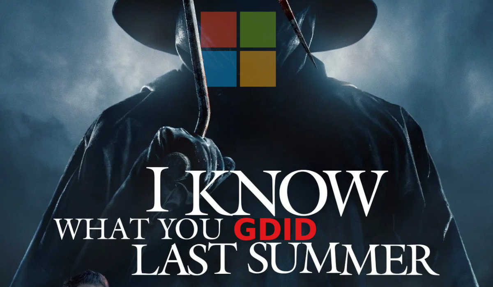
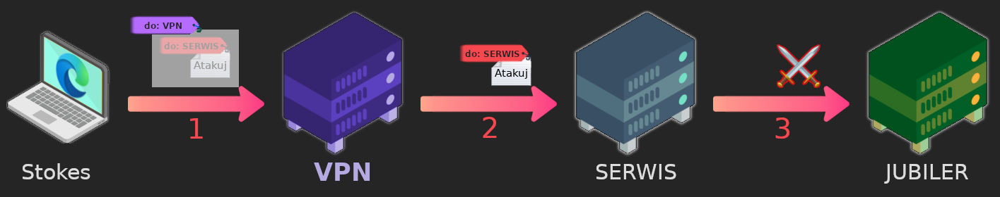
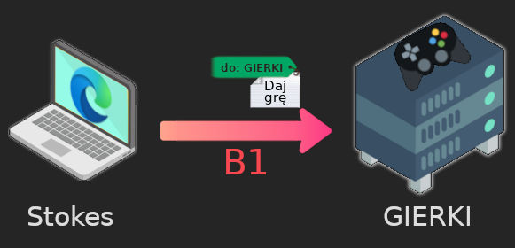
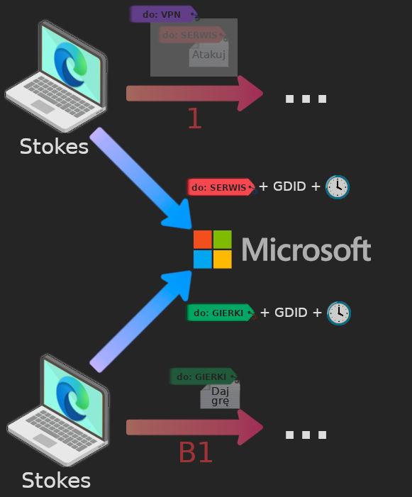

Kilka miesięcy temu złapano 19-latka z&nbsp;grupy hakerskiej, która włamywała się do systemów różnych firm. Pracownik amerykańskiego FBI przedstawił przed sądem solidne dowody jego winy.

Sprawa nie wyróżniałaby się na tle innych, gdyby nie pewien skrótowiec. **GDID**. *Global Device Identifier*.  
Tak nazywał się ciąg znaków, który przeglądarka oskarżonego czasem wysyłała do firmy Microsoft. Zawsze taki sam i&nbsp;niezmienny -- dzięki czemu na jego podstawie powiązano działania „zawodowe” (podczas których winny się maskował) z&nbsp;cywilnymi (podczas których się odsłonił).

A to wzbudziło żywe zainteresowanie. Bo choć dużo osób wiedziało, że ani system Windows, ani przeglądarka Edge zbytnio o&nbsp;prywatność nie dbają, jako duet okazały się aktywnie ją zwalczać.  
**Windows przydziela każdemu komputerowi osobisty numer, zaś Edge oznacza nim listę odwiedzonych stron**. Taki pakiet regularnie dają w&nbsp;prezencie korporacji Microsoft.

Ten jeden raz identyfikator pozwolił złapać młodego opryszka. Ale ile razy częściej posłużył do gorszych celów? Jak często pozwalał monitorować wędrówki ludzi po sieci, tworzyć ich profile, traktować ich jak obiekty do monetyzacji? Nie mówiąc o&nbsp;tym, że zebrane w&nbsp;ten sposób dane mogą w&nbsp;końcu wyciec (patrz: [afera Gravy Analytics](/2025/03/23/gravy-analytics-wyciek){:.internal}) i&nbsp;wpaść w&nbsp;ręce gorszych zbirów niż ten złapany?

Piszę o&nbsp;sprawie z&nbsp;opóźnieniem godnym słynnego Internet Explorera, też od Microsoftu. Nie zależy mi na świeżości newsa, bo będzie on tylko tłem wpisu. Jego sednem będzie naświetlenie kwestii trwałych i&nbsp;unikalnych identyfikatorów, czyli wyjątkowej zmory dla prywatności. Nie tylko na Windowsie.

Zapraszam!

{:.figure .bigspace-before}


{:.figcaption}
Źródło: [plakat](https://letterboxd.com/film/i-know-what-you-did-last-summer-2025/) filmu *I know what you did last summer*, logo Microsoftu. Przeróbki moje.

## Spis treści

* [Historia](#historia)
  * [Po stronie Stokesa](#po-stronie-stokesa)
  * [Po stronie śledczych](#po-stronie-śledczych)
* [Wesołe trio: Windows, GDID i&nbsp;Edge](#wesołe-trio-windows-gdid-iedge)
  * [GDID, czyli piętno noszone na czole](#gdid-czyli-piętno-noszone-na-czole)
  * [Linki, czyli historia życia na widelcu](#linki-czyli-historia-życia-na-widelcu)
* [Co można zrobić](#co-można-zrobić)
  * [Na Windowsie](#na-windowsie)
  * [Na Linuksie](#na-linuksie)

## Historia

Źródłem pierwotnym całej historii jest [dokument sądowy](https://www.justice.gov/usao-ndil/media/1450651/dl?inline), w&nbsp;którym pracownik FBI przedstawia dowody na to, że Stokes jest hakerem. Warto zaznaczyć, że nie jest to relacja chronologiczna, tylko prezentacja dowodów, czasem niezależnych od siebie. GDID to tylko jeden z&nbsp;wątków sprawy, a&nbsp;ułożenie spójnej historii wymaga uzupełnienia paru luk.

{:.post-meta .bigspace-after}
Nie gwarantuję, że moja interpretacja jest w&nbsp;100% zgodna z&nbsp;prawdą, zwłaszcza że warto zachować pewien dystans wobec samej relacji (o&nbsp;tym później). Ale sedno powinno się zgadzać.

To powiedziawszy, mogę zacząć opowieść.

### Po stronie Stokesa

Peter Stokes to młody człowiek z&nbsp;podwójnym, amerykańsko-estońskim obywatelstwem. Zainteresował się rzemiosłem hakerskim i&nbsp;wspólnie z&nbsp;pewnym gangiem przeprowadził serię cyberataków, w&nbsp;tym na jakąś niewskazaną z&nbsp;nazwy firmę jubilerską.

{% include info.html
type="Ciekawostka"
text="Szajka miała swoją wspólną, wirtualną przestrzeń na wynajętym serwerze. Można ją uznać za coś w&nbsp;rodzaju meliny, z&nbsp;której koordynowali ataki i&nbsp;gdzie gromadzili pliki związane z&nbsp;akcją.  
Mieli tam też anonimowy grupowy czat. Stokes pochwalił się raz na nim, że ma urodziny. Okazuje się, że faktycznie je miał tamtego dnia -- co po przejęciu meliny dało FBI kolejną poszlakę, którą wykorzystali w&nbsp;sądzie (źródło: str. 21&nbsp;dokumentu). To tak na dowód, że naprawdę nie był mistrzem skrytości."
%}

Poza meliną działali raczej osobno. Każdy z&nbsp;nich na własną rękę i&nbsp;odpowiedzialność łączył się z&nbsp;różnymi neutralnymi serwisami, których używali jako narzędzi pomocniczych.  
Wiedząc o&nbsp;ryzyku odkrycia, korzystali przy tym z&nbsp;**VPN-ów**, czyli pośredników sieciowych, za którymi ukrywali [adresy IP](/internetowa_inwigilacja/2021/06/11/adres-ip){:.internal} -- podstawowe identyfikatory nadawane przy wejściu do internetu, których w&nbsp;pewnym zakresie mogą (nad-)używać nawet zwykłe komercyjne firmy od reklam profilowanych.

Można powiedzieć w&nbsp;uproszczeniu, że typowa droga od hakera do jubilera była podzielona na następujące odcinki:

1. Haker → VPN
2. VPN → Serwis

   {:.post-meta}
   Serwis oznacza tu usługę użytą do ataku, np. do szybkiego wyciągania danych. Przykładem wymienionym w&nbsp;dokumencie był Ngrok, ale nie ma to większego znaczenia -- liczy się to, że Serwis stał między VPN-em a&nbsp;celem ataku.

3. Serwis → Jubiler

Niżej schemat dla wzrokowców.

{:.bigspace-before}




{:.bigspace-before}
Półprzezroczyty prostokąt nad odcinkiem 1&nbsp;oznacza tu szyfrowanie danych -- lecąc przez sieć, były nieczytelne dla postronnych. Dane między VPN-em a&nbsp;Serwisem też były pewnie szyfrowane, ale zrezygnowałem z&nbsp;drugiego prostokąta dla lepszej czytelności.

Źródła ikonek: [logo przeglądarki Edge](https://commons.wikimedia.org/wiki/File:Microsoft_Edge_logo_(2019).svg) z&nbsp;*Wikimedia Commons*. Ikony z&nbsp;serwisu *Flaticon*: [serwer](https://www.flaticon.com/free-icon/server_742282) od *Smashicons*, [laptop](https://www.flaticon.com/free-icon/laptop-screen_2888701) od *vectorsmarket15*, [etykieta bagażu](https://www.flaticon.com/free-icon/tag_9426770) od *juicy_fish*. Skrzyżowane [miecze](https://emojipedia.org/google/emoji-18.0/crossed-swords) z&nbsp;*Emojipedii*.  
Przeróbki i&nbsp;aranżacja moje.



Po robocie młody haker chciał się czasem rozerwać. Odłączał się od wszelkich VPN-ów i, już jako zwykły cywil, odwiedzał przez ten sam komputer swoje media społecznościowe. Albo odpalał gierki:

{:.bigspace-before}


{:.figcaption}
Źródła jak wyżej, plus [pad do gier](https://emojipedia.org/video-game#designs) z&nbsp;Emojipedii.

### Po stronie śledczych

FBI musiało przejść tę samą drogę co wyżej, tyle że w&nbsp;drugą stronę -- **od celu ataku do komputera, który ten atak zlecił**.

Najpierw dostali pewnie zgłoszenie o&nbsp;cyberataku. Poprosili jubilera o&nbsp;zapiski (*logi*) z&nbsp;serwerów i&nbsp;na tej podstawie ustalili, jakie adresy IP go atakowały. Wyszło na jaw, że należały do Serwisu. W&nbsp;ten sposób poznali odcinek numer 3&nbsp;ze schematu.

Potem zwrócili się do Serwisu. Zakładam, że był on jakąś neutralną usługą, gotową współpracować z&nbsp;władzami. Zatem wydał im dane dotyczące adresów IP, jakie się z&nbsp;nim łączyły. Ten, który nakazał atak, okazał się należeć do VPN-a. W&nbsp;ten sposób śledczy poznali odcinek numer 2.

Na tym etapie pewnie zwrócili się do VPN-a. I&nbsp;niewykluczone, że zostali spławieni. Może jego właściciel był poza ich jurysdykcją. Albo na bieżąco czyścił zapiski serwerów -- w&nbsp;takim wypadku nawet gdyby przekazał wszystko co ma, to wszystko byłoby niczym.

Odcinek 1&nbsp;pozostał dla nich zatem tajemnicą. Mieli jedynie trochę kompletów danych złożonych z:

1. dokładnych godzin połączenia z&nbsp;Serwisem,
2. adresu (lub adresów) IP tego Serwisu.

Pozostała im nadzieja, że gdzieś u&nbsp;kogoś znajdą pasujące komplety danych. I, jak się okazuje, **były takie u&nbsp;Microsoftu. Zapewne w&nbsp;bazie danych telemetrycznych, jakie wysyła im przeglądarka Edge**.  
Pasowały znaczniki czasu, pasowały adresy docelowe. Był również numer GDID, bohater tego odcinka. Ciąg znaków odpowiadający konkretnemu urządzeniu.

Sprawdzając bazy Microsoftu pod kątem tego numeru, śledczy zapewne trafili na inne dane telemetryczne, dla innych godzin i&nbsp;adresów docelowych. Interakcje z&nbsp;grami online, przy których relaksował się Stokes. A&nbsp;także z&nbsp;social mediami: Snapchatem i&nbsp;Facebookiem.

W ten sposób pojawiły się punkty wspólne, łączące oś czasu „zawodową” z&nbsp;prywatną.

{:.bigspace-before}


{:.figcaption}
W rzeczywistości Stokes używał do obu rzeczy tego samego komputera. Ale powieliłem ikonę laptopa, żeby nawiązać naraz do dwóch poprzednich schematów.  
Źródła jak wcześniej, plus [zegar](https://emojipedia.org/noto-color-emoji/18.0/four-oclock) z&nbsp;Emojipedii.

{% include info.html
type="Szczypta gdybania"
text="Bardzo możliwe, że we wspomnianych danych Microsoftu był również prawdziwy adres IP Stokesa. Ten sprzed połączenia się z&nbsp;VPN-em, czyli rozwiązanie zagadki. Nie znalazłem tej informacji w&nbsp;dokumencie, ale tak podpowiada intuicja.  
Ale nawet gdyby służby go nie miały, to na tym etapie mogłyby poprosić portal od gier albo social media o&nbsp;adresy IP z&nbsp;określonych godzin, poznanych u&nbsp;Microsoftu. W&nbsp;ten sposób dotarliby do adresu Stokesa, bo po godzinach nie używał VPN-a."
%}

Stokes zostawił aż trzy wspólne punkty między życiem cywilnym a&nbsp;„zawodowym”: komputer, system oraz przeglądarkę. Do tego w&nbsp;najbardziej „gadatliwej” kombinacji. Wolał rozrywki cyfrowe od relaksu na łonie natury, bez elektroniki. I&nbsp;chwalił się drogimi ciuchami, skąpiąc przy tym na osobny komputer od brudnych spraw.  
Te fakty okazały się jego zgubą.



{:.bigspace-before}
Uważne osoby zauważą, że ostatni schemat pokazuje adres Serwisu trafiający do Microsoftu, mimo że pierwszym punktem kontaktu był dla Stokesa VPN -- z&nbsp;założenia maskujący adres docelowy.

Zdecydowałem się na takie przedstawienie zdarzeń, choć ciut mi zgrzyta i&nbsp;nawet Microsoftu nie podejrzewałem o&nbsp;takie zbieractwo. Ale spójrzcie sami na stronę 34&nbsp;[dokumentu](https://www.justice.gov/usao-ndil/media/1450651/dl?inline), punkt&nbsp;27. Znajdziemy tam takie fragmenty:

> Microsoft records also indicate: (1) the (...) GDID accessed multiple sites from \[NAZWA VPN-A\] including the .168
server (...); and (2) the user of the device assigned the GDID (...) visited \[STRONA ATAKOWANEJ FIRMY\] from the .168 proxy server.

*Proxy* to ogólne określenie pośrednika, odnosi się do VPN-a. Fragment mówi zatem, że **Microsoft miał w&nbsp;danych zarówno kontakty z&nbsp;VPN-em, jak i&nbsp;kontakty (przez VPN-a) ze stronami docelowymi**.

Zakładam, że w&nbsp;oskarżeniu, z&nbsp;założenia precyzyjnym i&nbsp;odpornym na podważanie, nie ma skrótów myślowych („Microsoft powiedział o&nbsp;VPN-ie, ale wiemy, jaka za nim była strona i&nbsp;napiszemy, że powiedział o&nbsp;stronie” -- tak to raczej nie działa).

Pozostaje taki wniosek: Edge ujawniał adres końcowy, olewając VPN-a. 

Jak to mogło wyglądać od strony technicznej?  
Na przykład tak, że najpierw Stokes prosi o&nbsp;połączenia ze stroną Serwisu, klikając link w&nbsp;Edge'u. Telemetria kopiuje ten link i&nbsp;wysyła go do Microsoftu. A&nbsp;dopiero na sam koniec VPN (np. w&nbsp;postaci osobnego procesu albo dodatku do przeglądarki) opakowuje prośbę Stokesa we własne szyfry i&nbsp;przekierowuje do siebie.

Jeśli tak było, to mielibyśmy naprawdę grube ujawnianie danych. Nie ocenię tego jednoznacznie, nie wiedząc jak działał VPN Stokesa. Ale wiele na to wskazuje.





{:.bigspace-before}
Uprzedziłem wcześniej, żeby nie brać relacji agenta FBI za pewnik i&nbsp;jedyne źródło prawdy.  
A to dlatego, że w&nbsp;realiach służb w&nbsp;USA -- zarówno zwykłej policji, jak i&nbsp;bardziej tajniackich -- istnieje coś takiego jak **_parallel construction_** (po polsku coś w&nbsp;stylu: „budowa równoległej podstawy dowodowej”).

Czasem dowody w&nbsp;sprawie są zbierane za pomocą środków, do których służby wolą się nie przyznawać. Być może zrobiły coś niekoniecznie legalnego? Albo użyły swoich asów w&nbsp;rękawie, które chcą zachować na przyszłość?

W takim wypadku wykorzystują część informacji do stworzenia zmyślonej historii zdobycia dowodów. Bezpieczniejszej dla nich, a&nbsp;przy tym wiarygodnej i&nbsp;akceptowalnej dla sądu.

Nie można wykluczyć, że tu również zaszło coś takiego. Widzę co najmniej dwa alternatywne sposoby ustalenia winnego, z&nbsp;którymi by się nie afiszowali:

1. VPN, z&nbsp;którego korzystał haker, mógł być tak naprawdę *honeypotem* -- zastawioną celowo, kuszącą pułapką. Śledczy nie chcieliby tego ujawniać, bo może jeszcze pomóc przy niejednej sprawie.
2. Mogli sięgnąć po mocniejsze zabawki szpiegowskie.

   Może na przykład USA całkiem zdominowało firmy telekomunikacyjne Estonii/ZEA (krajów, z&nbsp;których łączył się Stokes)? Do tego stopnia, że mają zapisy wszystkich interakcji użytkowników z&nbsp;„interesującymi” serwisami, jak VPN-y, wraz z&nbsp;godzinami i&nbsp;adresami IP?

{:.post-meta .bigspace-after}
Przenosząc oba przypadki na schemat -- możliwe, że idąc od końca służby nie musiały się zatrzymać na etapie VPN-a i&nbsp;również odcinek numer 1&nbsp;stał się dla nich widoczny, gdy o&nbsp;to poprosili.

Nie wiem, jak było naprawdę. I&nbsp;nie sądzę, żebym się dowiedział. Sprawa GDID jest dla mnie wystarczająco ciekawa, więc reszta wpisu będzie zakładała, że istotnie użyto tego identyfikatora.  
...Ale ogólnie warto mieć z&nbsp;tyłu głowy, że wyjaśnienie oficjalne nie zawsze jest tym prawdziwym.



## Wesołe trio: Windows, GDID i&nbsp;Edge

Sprawę Stokesa można odsunąć w&nbsp;tło. Teraz czas przejść do metod śledzenia i&nbsp;naruszania prywatności (głównie niewinnych ludzi), które zostały dzięki niej nagłośnione. Mimo swojej obecności w&nbsp;tytule, GDID wcale nie będzie tu najgorszą rzeczą.

### GDID, czyli piętno noszone na czole

Według dokumentu Stokes miał taki numer GDID:

```
g:6755467234350028
```

Skoro jest długi ciąg znaków, to jest niemała szansa, że to coś **unikalnie identyfikującego**. Tak w&nbsp;istocie jest; o&nbsp;ile nie nastąpi nieprawdopodobny przypadek albo celowa ingerencja, to każdy użytkownik Windowsa będzie miał swój własny GDID, inny niż te u&nbsp;innych osob.

{% include info.html
type="Źródło faktów"
text="W tym temacie bardzo polecam [relację z&nbsp;X/Twittera](https://x.com/massgravel/status/2074304593303892354) od użytkownika o&nbsp;nicku `massgravel` (zamiast `x.com` można wstawić adres którejś [instancji Nittera](https://status.d420.de/), żeby czytać bez konta).  
Autor opisuje identyfikator od strony ciut bardziej technicznej, ale nadal zrozumiałej. Są też ciekawe fakty: jak ten, że GDID to zapewne *rebranding* czegoś, co nazywało się *Passport Unique ID* (dlatego w&nbsp;dokumentach Microsoftu częściej mamy *PUID* niż *GDID*)."
%}

Jego cecha szczególna: **trwałość**. GDID zostaje przydzielony po pierwszej aktywacji Windowsa i&nbsp;potem się już nie zmienia.

{:.post-meta .bigspace-after}
Proponuję jednak nie zakładać, że brak aktywacji konta uchroni przed otrzymaniem GDID-a. Różne osoby z&nbsp;Windowsami bez konta sugerują, że też mają ten numer; może zastępczy, stworzony na podstawie numerów seryjnych sprzętu.

Można włączać i&nbsp;wyłączać komputer, zmieniać różne publicznie dostępne ustawienia w&nbsp;menu, instalować nowe programy, dorobić się przez lata siwych włosów... A&nbsp;GDID pozostaje ten sam.  
Można go natomiast zmienić, wykonując ponowną instalację całego systemu. Dostanie się wtedy nowy GDID, niezmienny do czasu kolejnego przeinstalowania. I&nbsp;tak dalej.

Połączenie obu wyróżnionych cech sprawia, że GDID to czystej krwi **trwały identyfikator** (ang. *persistent identifier*). Coś, co pozwala jednoznacznie rozpoznawać konkretnego człowieka w&nbsp;dłuższym okresie czasu. Każdemu, kto będzie miał okazję widzieć ten ciąg znaków w&nbsp;różnych sytuacjach.

W tym wypadku tym kimś jest firma Microsoft, to akurat prosta sprawa.

Ciekawsze jest natomiast, *w jaki sposób* GDID do niej trafia. Bo rola Windowsa, z&nbsp;tego co rozumiem, kończy się na *przydzieleniu* identyfikatora. Potem, jak pałeczkę podczas sztafety, przejmuje go i&nbsp;podaje swoim twórcom **przeglądarka Edge**.

Wiele wskazuje na to, że Stokes miał włączoną telemetrię. W&nbsp;takim przypadku przeglądarka co pewien czas wysyła do Microsoftu komplet informacji: znaczniki czasu, numer GDID odczytany z&nbsp;systemu. No i&nbsp;linki do odwiedzanych stron.

### Linki, czyli historia życia na widelcu

Choć GDID zgarnął całą uwagę, przypięte do niego linki mogą być jeszcze gorsze. Na stronie&nbsp;34 [dokumentu sądowego](https://www.justice.gov/usao-ndil/media/1450651/dl?inline) jest taki przykład:

> According to Microsoft records, (...) when (...) the ngrok account was created — the device with the GDID accessed, among other ngrok pages, https://dashboard.ngrok.com/signup

Dla niektórych adres jak adres, ale inni mogą unieść brwi. Problem zaznaczyłem na czerwono:

<pre class="bigspace black-bg mono">https://dashboard.ngrok.com<span class="red">/signup</span></pre>

Fragment na biało to **domena** (plus protokół, ale to pominę).  
Sama jej nazwa, w&nbsp;połączeniu z&nbsp;czasem połączenia, [też ujawnia trochę informacji](/internetowa_inwigilacja/2022/08/13/metadane-esni-ech){:.internal}. Ale powiedzmy, że przesyłanie domen na widoku jest powszechne, widzą je choćby firmy telekomunikacyjne.

{:.post-meta .bigspace-after}
Z drugiej strony VPN ma z&nbsp;założenia ukrywać nawet domeny, więc wgląd Microsoftu w&nbsp;ich nazwy nadal byłby naruszeniem prywatnościowych oczekiwań.

Reszta linku, na czerwono, to już grubsza sprawa. **To coś, co z&nbsp;założenia jest szyfrowane. Sprawa prywatna między człowiekiem a&nbsp;odwiedzaną stroną**. Po domenie mogą się trafiać naprawdę wrażliwe rzeczy:

* nazwa konkretnego konta w&nbsp;mediach społecznościowych (już nie `facebook.com`, tylko `facebook.com/andrzej.przykladowy`);
* wiele mówiące podstrony (już nie `zdrowie-fejk.pl`, tylko `zdrowie-fejk.pl/czy-mam-chorobe-weneryczna`);
* [parametry po znaku zapytania](/internetowa_inwigilacja/2021/04/09/internetowa-inwigilacja-parametry){:.internal}, które mogą wskazywać konkretne konto na portalu, film z&nbsp;YouTube'a albo innych serwisów, identyfikatory transakcji płatniczych, unikalne i&nbsp;spersonalizowane strony (`?nr_pacjenta=12ab34cd`)... A&nbsp;czasem nawet hasła dostępu (choć wpychanie ich do linku byłoby już fuszerką ze strony twórców stron).

A tutaj jak gdyby nigdy nic piszą, że Microsoft miał w&nbsp;danych pełen adres.

Może FBI się zamotało? Tyle że pewien użytkownik sprawdził Edge'a i&nbsp;[potwierdził niezależnie](https://x.com/massgravel/status/2074304613553958973), że w&nbsp;ramach telemetrii wysyłane są pełne adresy, nie tylko nazwy domen.  
I nie jest to losowy pieniacz z&nbsp;X/Twittera, tylko osoba, która stworzyła szalenie popularny program do omijania dziwactw Windowsa (prawie 200&nbsp;tys. gwiazdek na Githubie).

{:.post-meta .bigspace-after}
Na [stronie projektu](https://github.com/massgravel/Microsoft-Activation-Scripts) można znaleźć link do tego konkretnego konta na X/Twitterze. To potwierdza powiązanie między projektem a&nbsp;jego profilami.

I Microsoft rzekomo zbiera to wszystko w&nbsp;jednym miejscu, oznaczone wspólnym numerem. Można zobaczyć jak na dłoni, jakie ktoś ma konta w&nbsp;social mediach, co czyta, jakie filmiki ogląda.

Powiem tyle: cieszę się, że już naprawdę mało mam wspólnego z&nbsp;Windowsem. I&nbsp;myślę, że w&nbsp;tym momencie zwykli ludzie, dalecy od jakiegokolwiek hakerstwa, mogliby się zaniepokoić i&nbsp;zacząć chronić swoje dane. 

## Co można zrobić

### Na Windowsie

Zacznę od Windowsa, którego dotyczyła cała sprawa.

Pozwolę sobie pominąć opcję „wyłączyć telemetrię w&nbsp;Edge'u”. Znając Microsoft, włączy się sama przy kolejnej aktualzacji.  
Mocno zachęcam, żeby zamiast tego **zmienić przeglądarkę na prywatniejszą, jak Brave albo Firefox**. To takie minimum, jakie można zrobić, żeby nie zbierali historii naszego życia.

{:.post-meta .bigspace-after}
Są też inne przeglądarki. Jak Librewolf, którego sam często używam. Albo Mullvad Browser, którego nie testowałem, ale widziałem pozytywne opinie. Opcji jest niemało, warto się rozglądać za niekorporacyjnymi.

Rozwiąże to sprawę konkretnego programu (Edge'a), ale pod spodem nadal będzie tkwił GDID, przypisany do komputera i&nbsp;rzadko zmieniany. Inne programy też mogą do niego sięgać.

Dlatego można pójść o&nbsp;krok dalej i&nbsp;**zmienić system na coś na bazie Linuksa**. W&nbsp;obecnych czasach to naprawdę nic niszowego, [Linux jest na fali](/2025/04/22/koniec-windows-10-rok-linuksa){:.internal}, poradników i&nbsp;filmików instruktażowych jest multum.



### Na Linuksie

{:.post-meta .bigspace-after}
Obowiązkowy wstęp: Linux nie jest jednym systemem, tylko całą ich galaktyką. Łączy je wszystkie wspólna część, fundament (*jądro*) całego systemu. Czyli właśnie Linux.

Zacznę od złej wiadomości: **Linux też ma swój identyfikator, `machine-id`**. Wprowadzony ponoć bez złych intencji, tylko po to, żeby maszyny połączone w&nbsp;sieć (np. lokalną) mogły się rozpoznawać. Znajduje się on w&nbsp;pliku `/etc/machine-id`; poza tym jest też `/var/lib/dbus/machine-id`, ale to zwykle skrót do tego pierwszego.

Motywacja twórców nie zmienia faktu, że po instalacji systemu dostaje się numer, numer się sam nie zmienia, inne programy mogą do niego sięgać. Liiipa.  
Można go dość łatwo zmienić, ale ja zaproponuję coś innego. Coś, co rozwiąże zarówno problem jego trwałości, jak i&nbsp;faktu, że niektórzy nie chcą albo nie mogą tak całkiem zostawić Windowsa.

Mianowicie: można spróbować używać Linuksów [w trybie ulotnym (*live USB*)](/2026/10/29/systemy-live-prywatnosc){:.internal}.  
Polega to na tym, że tworzy się w&nbsp;łatwy sposób „pendrive'a linuksowego”, na którym ma się wybraną odmianę (*dystrybucję*) Linuksa, choćby popularnego Minta. Albo kilka takich odmian.

Tego pendrive'a wkłada się do portu USB, naciska się kombinację przycisków -- i&nbsp;zrobione, włącza się świeży Linux, podczas gdy Windows zainstalowany na dysku sobie śpi, nieruszany i&nbsp;nieświadomy drugiego systemu.

Po każdym załadowaniu systemu ulotnego **dostaje się nowy identyfikator `machine-id`**. Przynajmniej na Linuksach, które sprawdzałem. Resetują się też inne dane identyfikujące: nazwa profili Firefoksa, pliki z&nbsp;ustawieniami, historia otwieranych plików... Jak wielki reset tożsamości.

A po wyłączeniu tego systemu można wyjąć pendrive'a, uruchomić domyślnego Windowsa i&nbsp;nadal z&nbsp;niego korzystać, jeśli jest taka potrzeba. Nie trzeba robić nic nieodwracalnego.



{:.bigspace-before}
Ulotność nie rozwiązuje niestety problemu wszystkich identyfikatorów.  
Oprócz tych na poziomie programów i&nbsp;systemu istnieją jeszcze **identyfikatory sprzętowe**, związane z&nbsp;fizycznymi elementami komputera. Jak numery seryjne dysku i&nbsp;płyty głównej albo adresy MAC różnych modułów od łączności.

Przeciwko nim można wytoczyć rozwiązania, które nazywam roboczo **prywatnością przez izolację**.  
Polega to w&nbsp;skrócie na tym, że narzuca się programom ograniczenia. „Możesz zaglądać tylko do folderów A&nbsp;i B, a&nbsp;do tych z&nbsp;wrażliwymi rzeczami nie możesz”. Jest kilka stopni takiej izolacji:

* izolacja lekka, mechanizmami ochronnymi Linuksa -- na przykład przez program Firejail  
  (ma komendę `firecfg`, która natychmiastowo ogranicza wiele znanych programów);
* izolacja cięższa (*wirtualizacja*)  
  (polega na użyciu programu zwanego [maszyną wirtualną](/2025/02/10/prywatnosc-maszyny-wirtualne){:.internal}, w&nbsp;którym uruchamia się osobny system).



Łącząc prywatność przez ulotność z&nbsp;prywatnością przez izolację, nawet tą lżejszą, ma się już naprawdę potężną ochronę.  
Ale nawet najzwyklejsze przejście z&nbsp;Windowsa na Linuksa -- bez całej tej ulotności czy izolacji -- dałoby wielką poprawę w&nbsp;porównaniu z&nbsp;sytuacją na Windowsie. Dlatego gorąco do tego zachęcam!

{% include info.html
type="Krótko o&nbsp;smartfonach"
text="Smartfony są poza tematem tego wpisu, dotyczy on głównie komputerów. Ale mając taką okazję, wręcz muszę wspomnieć o&nbsp;tym, że **ich główne identyfikatory można wyłączyć w&nbsp;ciągu sekund**. Rewelacyjny stosunek wysiłku do efektów, polecam każdemu!  
Oto [krótki opis](/2025/03/23/gravy-analytics-wyciek#usuwanie-id-reklamowego){:.internal}, jak wyłączyć ID reklamowe na smartfonach z&nbsp;systemami Android i&nbsp;iOS.  
I fakty motywujące: te numery były łączone z&nbsp;danymi lokalizacyjnymi i&nbsp;trafiały do brokerów danych, przez co podczas afery Gravy Analytics przejęli je hakerzy (opis w&nbsp;podlinkowanym wyżej wpisie). Do tego rosyjski Yandex używał ich do [łączenia użytkowników aplikacji z&nbsp;historią odwiedzanych stron](/2025/07/23/facebook-yandex-localhost-tracking){:.internal}."
%}

A jeśli ktoś *musi* korzystać z&nbsp;inwazyjnych programów, które próbują grzebać w&nbsp;poszukiwaniu trwałych identyfikatorów, buntują się przeciw jakiejkolwiek izolacji, a&nbsp;do tego są odgórnie narzucone?  
W takim wypadku pozostaje chyba **używanie osobnego urządzenia do spraw prywatnych i&nbsp;osobnego do inwazyjnych programów**. Brzmi to rozczarowująco... Ale hej! Już za kilka stówek można kupić laptopa poleasingowego, który naprawdę wystarczy do codziennego życia.

To kilka razy mniej, niż płacił Stokes za jeden nocleg w&nbsp;hotelu -- nim zamienił apartamenty na więzienną celę :sunglasses:

