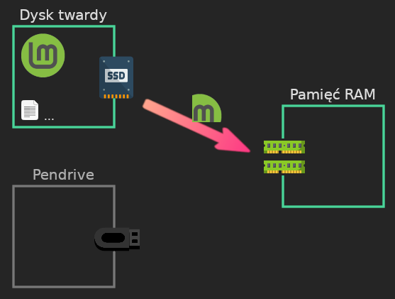
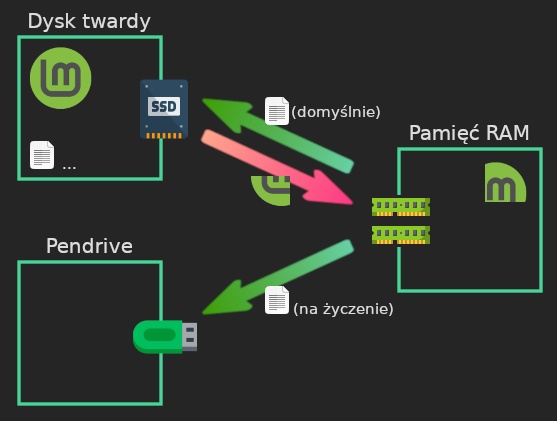
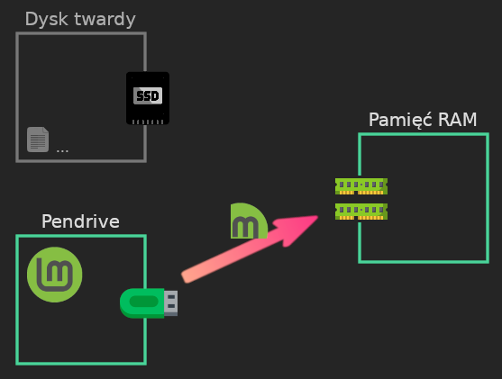
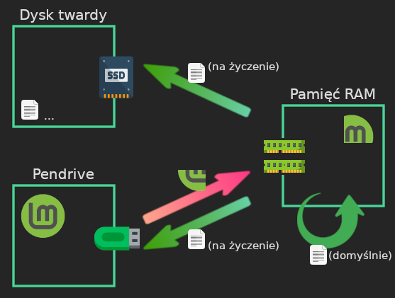



Na razie zostawię tu parę schematów porównujących ruch plików na systemie klasycznym i&nbsp;ulotnym. To z&nbsp;tego wynika parę cech trybu ulotnego, które można próbować zmienić i&nbsp;dostosować, żeby lepiej się spisywał.

{:.bigspace}


{:.bigspace-before}
Faza uruchamiania systemu:

{:.bigspace-before}


Ikony ze strony Flaticon: [dysk SSD](https://www.flaticon.com/free-icon/ssd_4854407) od *Hilmy Abiyyu A.*, [pamięć RAM](https://www.flaticon.com/free-icon/computer_16007225) od *JK-Icon*, [pendrive](https://www.flaticon.com/free-icon/pendrive_167505) od *Magnific*. Oficjalne logo systemu Linux Mint. Przeróbki moje.


Faza korzystania z&nbsp;systemu:

{:.bigspace-before}



{:.bigspace}


{:.bigspace-before}
Faza uruchamiania systemu:

{:.bigspace-before}

Faza korzystania z&nbsp;systemu:

{:.bigspace-before}



